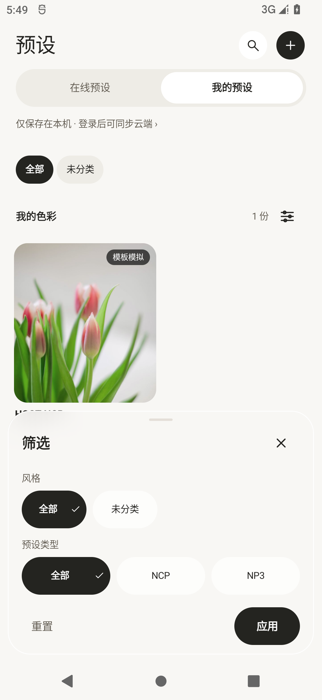
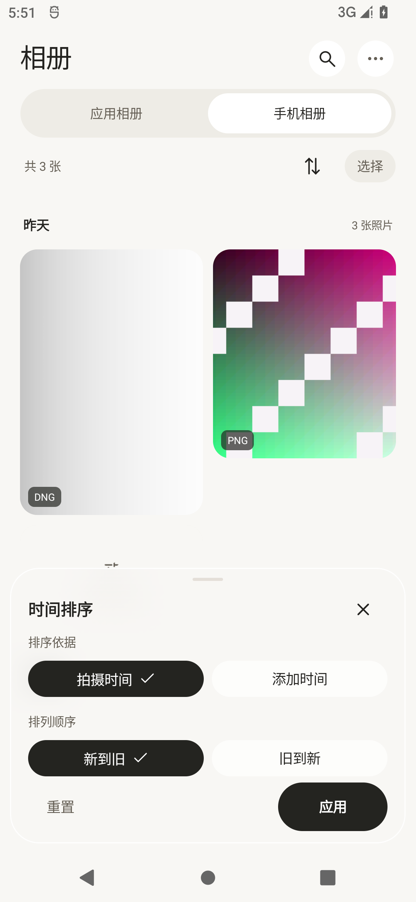
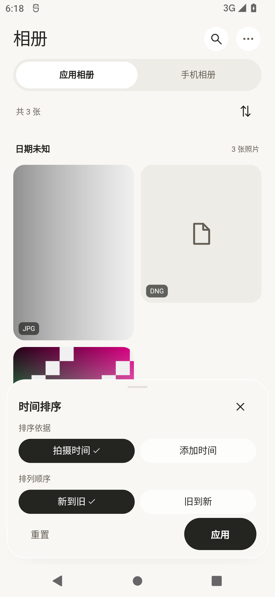
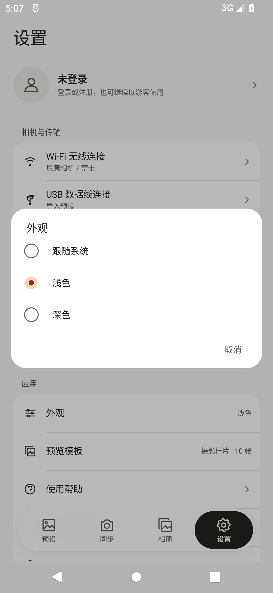
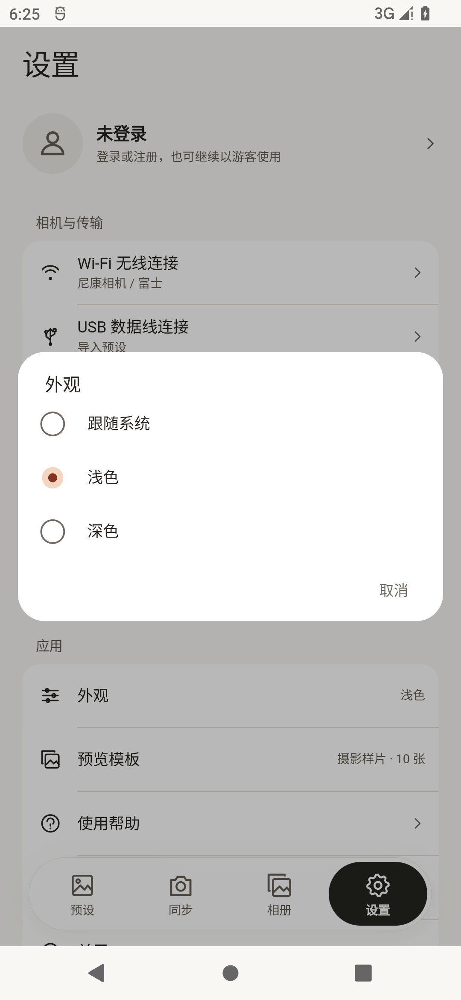
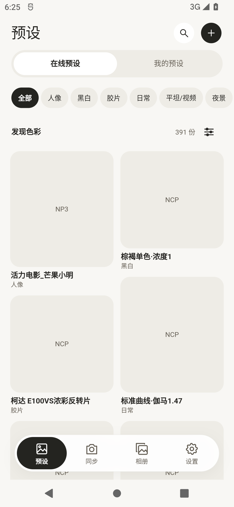
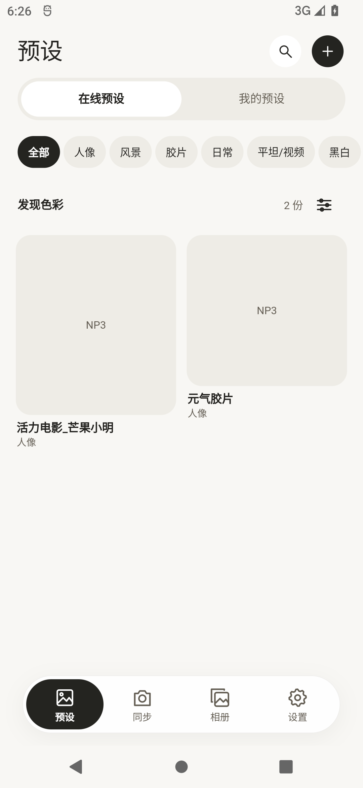

# 190 筛选、排序与在线库验证

190 源码固定为 `d82c9e478194210af85e08127bdb584d24bb0dd7`。Android 构建使用工作区内的独立检出，排除另一个任务正在进行的原版 191 Wi-Fi 修复；该构建输入的原 420 个文件保留校验通过。187/188/189 安装包和冻结记录保持原样。

- 预设筛选、相册排序及其余底部面板改用根导航显示，四个入口不再盖住面板。标题、操作区固定，长选项区可滚动；20 个 Android 界面场景通过，包含横竖屏和 2 倍字体。
- 在线仓库改用原 `useManagedEndpoint` 接入，升级时修复旧开发版的空/旧地址配置。完整目录用于格式、下载状态和未分类筛选；本地与在线条件分别保存于当前页面会话。真实 release 包已加载 391 份目录、打开详情并下载 NP3，已下载筛选按本地 SHA 匹配；同一文件的多个在线条目均可显示。
- 38 项 Android 原生检查和包含真实在线分页的完整 Flutter/native RAW 场景通过。隔离模拟器的 DNS 不可用，联网验证使用宿主已有代理；应用保留标准 HTTPS 校验。
- 最终两个 APK 的 ABI、版本、签名及 RAW 源码/动态库哈希已检查；两个人像模型与原 186 包一致，LiteRT release 动态库与 189 迁移包一致。此资产检查不代表人像功能已完成迁移。

| 原 186 | 最终共享 190 |
| --- | --- |
|  |  |
|  |  |
|  |  |

外观两端均选浅色。预设库截图的数据数量不同：共享版随后增加了真实在线下载的预设。底部操作区、网格列宽和弹窗宽度已对照；文字度量和标题区域仍有少量位置差异，不能标记全部页面逐像素验收完成。

精确包与证据哈希见 `../android12-controls-online-190-20261111.json`。iOS 同一提交的构建与真实线上分页、RAW 场景结果见 `../apple-mobile-190-20261111.json`。
