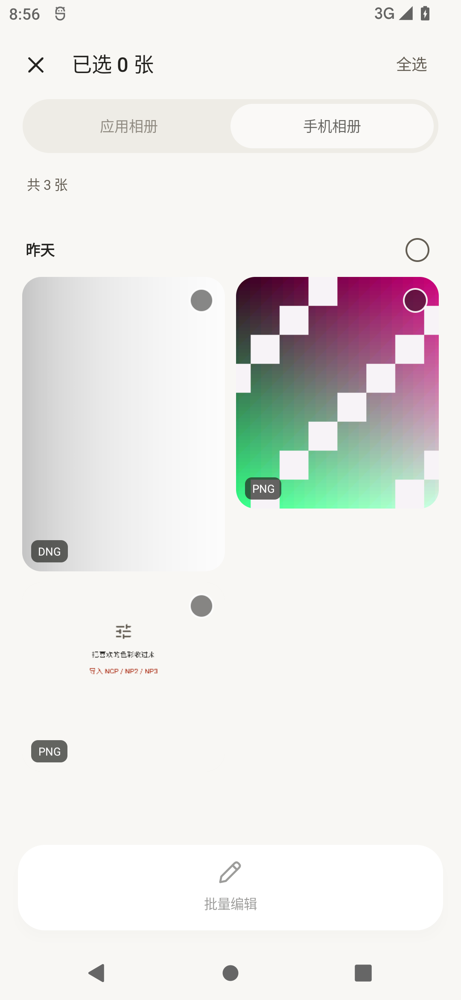
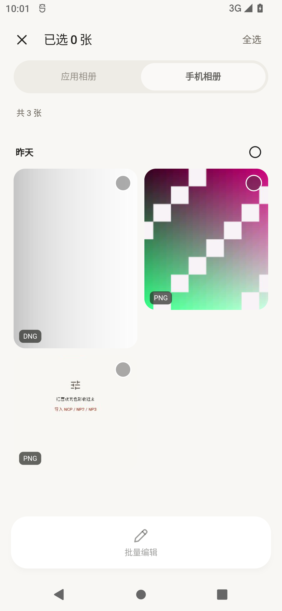
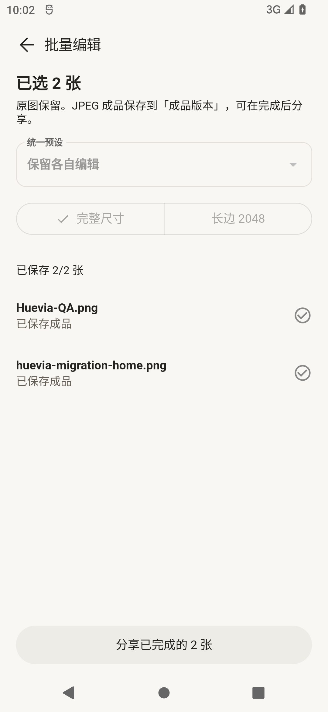
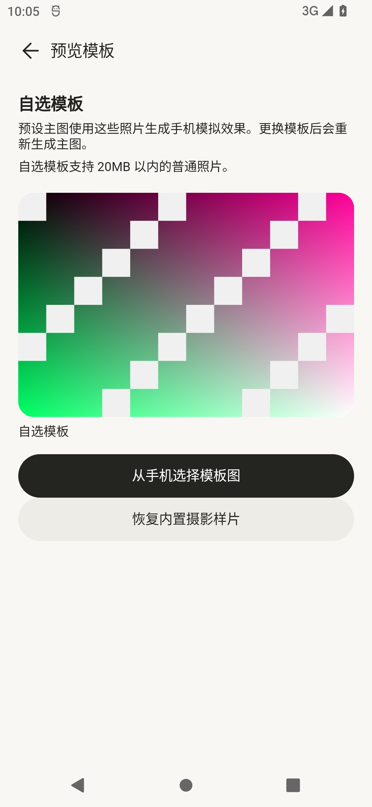
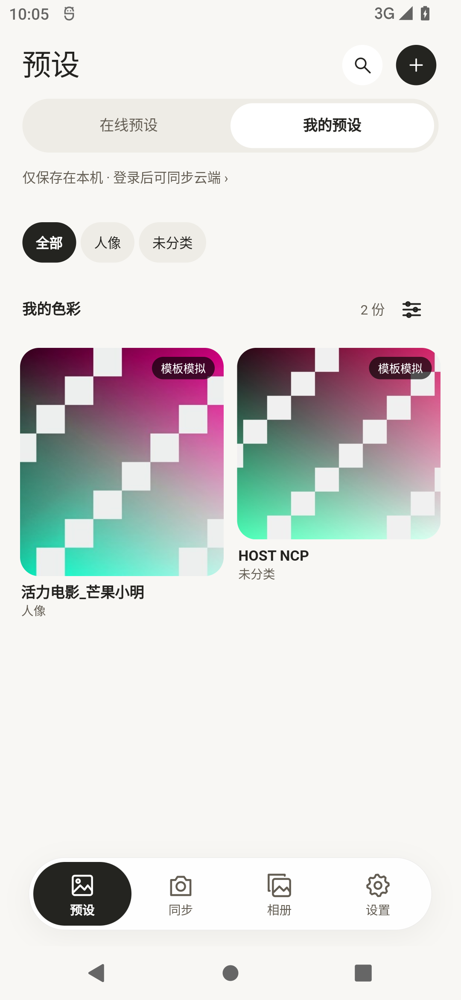
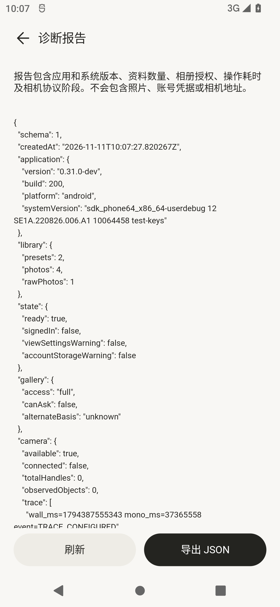
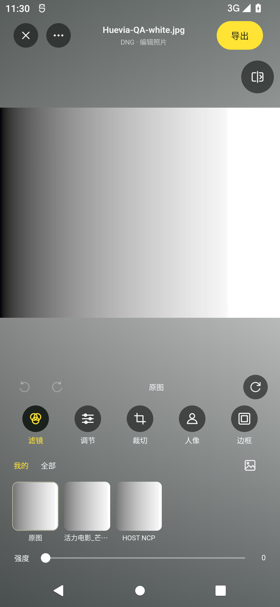

# 200 相册、批量处理与二级页面验证

Android 应用源码固定为 `bef616a5778b318152043426373336af3597972b`，版本 `0.31.0-dev+200`，开发包名 `cc.huevia.next`。构建工作目录为项目内的独立检出 `.tooling/m200`。186 样式参考和 187–190 的冻结记录保持原样；191、193 独立完成的原版修复按提交及 8 个文件的 Git blob 单独核验，其余 412 个原工程文件按原基准核验。

**Android 200 已由 201 替代。** 后续未缓存的大尺寸 RAW 实测发现 R8 改名了 JNI 回调，200 release 的既有小样片成功记录未覆盖这一失败路径。原安装包及冻结记录保留，修复、首次显影及三种完整尺寸导出证据见 [201 验证](../release-raw-201/README.md)。

## 本次实现

- 预设来源、两套来源各自的筛选条件、相册来源/筛选/时间排序偏好使用原生原子文件保存。文件损坏时保留原文件并提示，后续写入失败不会阻塞整个保存队列。
- iOS PhotoKit 接入授权状态、分页、缩略图、原始资源流式导入和图库变化通知。iOS 的第二种排序明确标注“修改时间”；相册公开 API 没有与 Android 入库时间完全等价的字段。[Apple 的修改时间定义](https://developer.apple.com/documentation/photos/phasset/modificationdate)
- 相册增加根页面批选、日期分组选取和最多 100 张的顺序处理。批处理先冻结各张配方，可保留各自编辑或统一预设；已完成成品保留，停止/重试只处理未完成项，账号变化会停止队列。配方快照总大小限制为 4 MiB，单张限制为 1 MiB。RAW 通过原显影链生成关联工作副本。
- 自选模板复用原生流式文件选择器，支持 20 MiB 以内的普通图片、规范化方向和白底、查看模板及恢复十张内置样片。更新会重新生成本地预设主图。
- 帮助、关于、许可和诊断二级页接线。诊断报告包含版本、授权、数量、固定操作名称/耗时和受限协议阶段记录，不导出账号凭据、照片内容、相机地址或私有路径。

## Android 实际证据

- 隔离 Android 12 / API 31，1080×2340、420 dpi、独立 adb 5038 / emulator-5584。
- 最终代码通过 27 个设备界面场景，包含批选/批量导出的横竖屏、双倍字体，以及保存失败重试、账号切换、筛选跨状态重建和模板选择器取消/恢复。见 `android-widget.log`。
- 39 项设备原生媒体检查通过。原生数值断言在 debug 测试宿主运行；release 包另外执行实际操作、AOT、ABI、签名、模型及运行库校验。见 `android-native.log`。
- 完整 Flutter/native 场景通过真实 PNG/JPEG、两张图片批量导出、自选模板透明白底、EXIF 6 方向恢复、合成 Bayer DNG/白色高光、导出版本、取消及原文件 SHA 不变检查。Android 原生输入与最终版本一致；该场景构建于 `6ce0054`，后续 Android 改动为共享界面及 Apple 测试配置。见 `android-pipeline.log`。
- JVM 检查包含 2168 项 NCP、43230 项局部编辑、15575 项 RAW/JPEG 色彩、243 项高光、31 项个人同步，以及 218 项共享边界/背景表面检查。见 `jvm.log` 与 `jvm-golden.json`。
- 最终 release 包实际从手机相册选择两张自制 PNG，导入原片、完成 2/2 成品，再通过系统分享交给无网络权限的本地 QA 接收器。接收器实际读取授权 URI 并校验：JPEG 1200×800 / 70,409 字节，JPEG 1080×2340 / 98,899 字节。SHA 见 `batch-share-receipt.json`。
- 诊断 JSON 实际通过 FileProvider 分享并被本地 QA 接收器读取，6,409 字节，SHA-256 `488ee419febeb8eb6a405879cb4f30022048eb7c7b19c18b8bcdb4f1d4cdb882`。文件为 `release-diagnostic-export.json`，接收证据为 `diagnostic-share-receipt.json`。验证只涉及隔离模拟器及本地接收器。
- release 包的系统文件选择器已实际选择 `Huevia-QA.png`，模板页面及预设主图更新；随后实际恢复内置样片。截图见下。
- release 包已实际打开自制 DNG、显影进入编辑器、完整尺寸导出并由本地接收器读取，JPEG 256×192 / 3,506 字节；见 `raw-release-supplement.json`。白色高光视觉正常，该样本未复现效果模型错误；未知型号 NEF 仍待实样验证。

`orientation-before-fix.log` 保留了 EXIF 方向检查发现的旧失败：Android 将无有效方向标记返回为 0。最终读图接口将其规范为 1，保留原图片字节；方向和尺寸断言完整保留。

## 同机视觉复核

两端均为手机相册、三张相同自制图片、未选中状态。四个首页入口在选择页和二级页下面，不遮挡操作区。

| 原版 186 | 共享版 200 release |
| --- | --- |
|  |  |

选择工具条两端的操作区域分别为 `74,1993–1006,2161` 和 `74,1994–1006,2162`；取消按钮位置相同，数量文字与全选操作已进一步对齐。来源禁用态、圆角、原铅笔路径、工具条尺寸和间距均已复核。来源标签字重、日期文字、部分取整及缩略图采样仍有差异，完整逐像素验收继续保留。

## Apple 验证

200 的 Apple 验证源码固定为 `ed5ffe7e0b5f3835438ebe92a2b6b441a9f004de`，[Actions 43022756099](https://github.com/1162107757/nikon-camera/actions/runs/43022756099) 已完整通过。该提交与 Android 冻结版本的差异为 Apple 原生目录规范化及集成测试配置；共享产品界面和 Android 产品输入保持一致。

已加入 PhotosUI 声明/链接，并让原生桥返回 Java 文件保护逻辑使用的规范目录，避免真机 `/var` 与 `/private/var` 别名冲突。`simctl privacy grant photos` 返回成功不能代替应用内授权状态，所以由 XCUITest 点击真正的系统完整访问选项，并由目标应用报告从 `none` 到 `full` 的实际变化。授权测试结束后，宿主用运行 nonce 打开门控，再直接启动同一应用完成全部原生场景；不依赖 Flutter 完成提示在 iOS 可访问性树中的展示。

41 项 Flutter 测试、218 项共享边界/表面检查、六组 JVM/Apple 指纹、真实 PhotoKit 分页/缩略图/原资源 SHA，以及完整图像、模板、批量和 RAW 场景通过。原始结果、系统授权日志、设备 IPA 报告及独立核验见 `apple/ios-final-evidence.json`。中间运行曾出现原生场景成功、XCTest 提示读取超时，首次结果和整体失败状态仍保存在 `apple/consent-first-pass*.json`，不将其改记为成功。

Flutter 官方 `allTestsPassed`、最终结果字典与运行 nonce/源码/样片 SHA 共同决定成功；结果缺失、失败、身份不符及场景数量不符都会拒绝。实际场景仍要求完整授权、真实 PhotoKit 资源 SHA 和全部媒体断言。[Flutter 固定版本的结果接口](https://github.com/flutter/flutter/blob/3.47.9/packages/integration_test/lib/integration_test.dart)、[Apple 有限照片访问](https://developer.apple.com/documentation/photokit/delivering-an-enhanced-privacy-experience-in-your-photos-app)

下载后的 IPA 另用 `cross-platform/tool/verify_ipa.py` 独立核验。除了源码、大小和哈希，还逐个检查主程序、Flutter、AOT 及其他原生框架的全部 Mach-O 切片，要求 ARM64/iPhoneOS；模拟器二进制、缺少 AOT、元数据不符或开发内核会被拒绝。此检查不代表已在实际 iPhone 安装。

## 保留范围

完整功能迁移仍在进行。系统图库发布/删除范围、完整批量编辑器、人像推理及局部/修复交互、交互裁切/分割对比、完整社区/QQ/头像、USB/槽位/遥控/连续传输、应用更新及旧资料迁移仍见 [完整清单](../../feature-parity.md)。应用相册的旧条目日期回填和完整拍摄时间排序仍需继续处理。

荣耀 Magic Android 12、未知型号 NEF、实际 iPhone 安装及有限授权/iCloud 等状态仍需实机验收。本次合成 RAW 与模拟器检查不替代这些实样和硬件结果。
