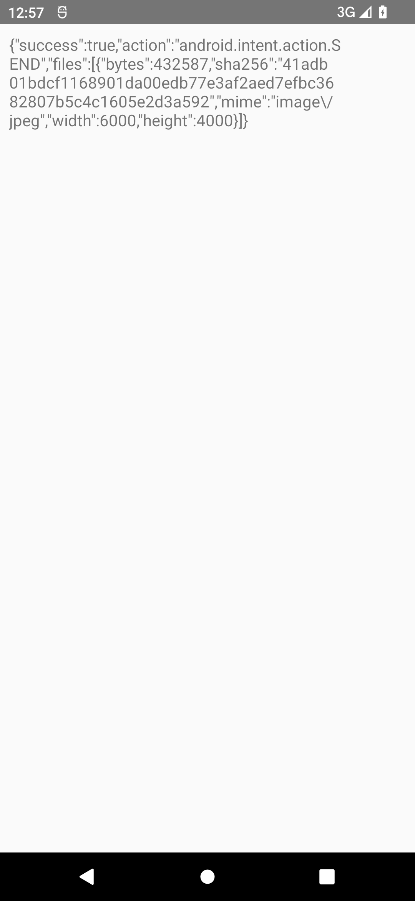
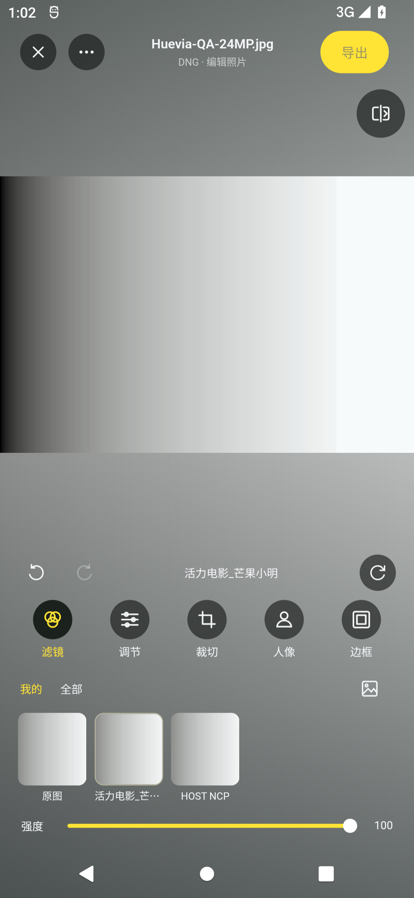

# 201 未缓存 RAW 与正式包验证

Android 源码固定为 `644a95e5eaffbe7056a1512300a2eb3829d31757`，应用版本 `0.31.0-dev+201`，包名 `cc.huevia.next`。APK 位于 `dist/migration201/`，使用开发签名，可与原版并存、更新先前迁移开发版。原工程的 420 个冻结输入仍按 8 个已批准修复 / 412 个原基准核验。

## 发现与修复

实际安装并核对 Android 200 release 的 SHA 后，用未缓存的自制 6000×4000 Bayer DNG 复现“原生组件不可用”。R8 映射把 JNI 查找的 `cancelled()`、`onProgress(double)` 改为 `a`、`c`。这条首次显影路径未被既有小样片成功记录覆盖。修复前截图、映射和安装包身份见 `before-*`。

201 增加上述方法及 JNI 返回构造器的精确保留规则，继续启用 R8/AOT。构建校验器现在检查最终 R8 映射；已验证其拒绝旧映射，并接受两种新 ABI 的实际映射。没有为测试保留整套运行时类。

## Android 12 release 实操

隔离模拟器 API 31、配置 2 GiB RAM、独立 adb 5038 / emulator-5584。`qa_fixture.py` 可重建同一自制样片：48,000,538 字节，SHA-256 `9d49202acf5d8926e1dee205c4b68071972189fd5ef2d2b9abd0f009298a06ed`，不含相机或用户照片。

- 首次显影后进入完整编辑器，另存原图，不修改输入 DNG。
- 实际完整尺寸导出，经无网络权限的本地 QA 接收器读取授权 FileProvider URI；三份 JPEG 均为 6000×4000。
- 原图成品：432,587 字节，SHA `41adb01bdcf1168901da00edb77e3af2aed7efbc3682807b5c4c1605e2d3a592`。
- `HOST NCP` 成品：432,586 字节，SHA `55d51297d0ea950a167095291a94d3090eb997f85c19b1983024f9c59cc19a28`。
- `活力电影_芒果小明` NP3 成品：430,839 字节，SHA `6cfb96acb6b6bfaa83ba4ecfe92dc6da666e8ce226cc2a5d455f057a80c4e9ff`。
- 三次操作进程 PID 保持 19165，针对该进程的崩溃缓冲区为空。两次导出阶段采样 PSS 分别约 189 / 194 MiB；采样不覆盖首次显影或所有瞬时峰值，也不代表荣耀实机内存上限。
- 两份 release APK 的签名、单 ABI、模型/运行库、ELF 与未压缩库 16 KiB 对齐通过。实际 x64 包覆盖上述操作；ARM64 尚未取得实体手机结果。

200 的 27 个设备界面场景和 debug 宿主 39 项原生检查作为原界面/算法回归记录保留；这里不把它们记作 201 release 的重新数值测试。精确文件、源码、哈希与验证边界见 `android-build-evidence.json`。

## Apple 与剩余范围

200 的系统授权、41 项 Flutter 测试及完整 PhotoKit/媒体/RAW CI 已通过；201 正在按同一流程构建设备 IPA。完整迁移及逐像素一致仍未完成，见 [功能清单](../../feature-parity.md) 和 [视觉清单](../../visual-acceptance.md)。荣耀 Magic Android 12、未知型号 NEF、实体 iPhone、有限照片权限/iCloud 仍需对应实样或硬件验收。
