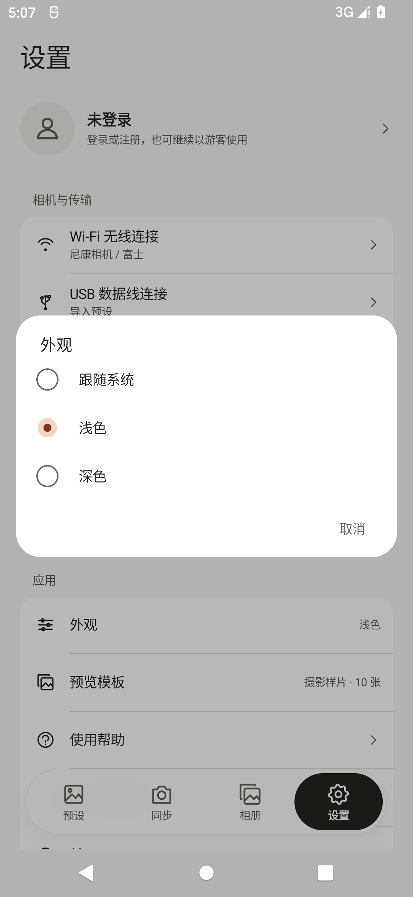
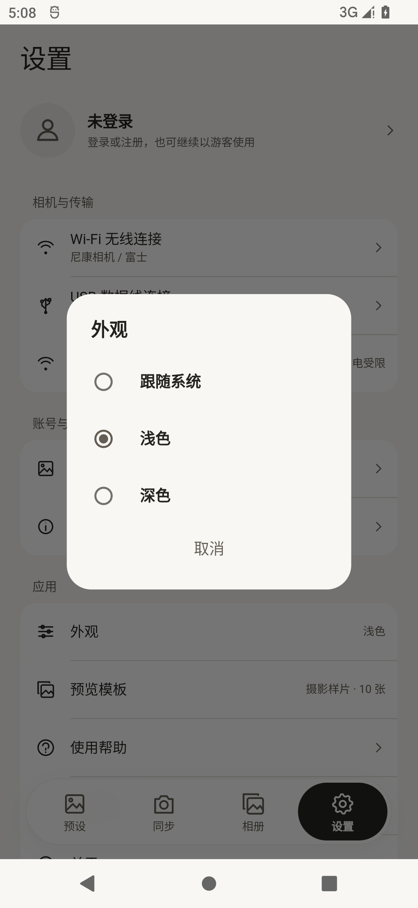

# 189 外观弹窗复核：未通过

同一 Android 12 模拟器、1080×2340、420 dpi，两端均选浅色。原版为 Android 186，共享版为最终 189 x64 release 包。实际边界及截图哈希见 `appearance-review.json`。

| 原版 186 | 共享版 189 |
| --- | --- |
|  |  |

共享版仍采用默认 SimpleDialog / RadioListTile：宽度、行高、标题和取消按钮位置、字重及选中标记均不同。此记录用于继续还原原设计，不代表样式验收完成。
